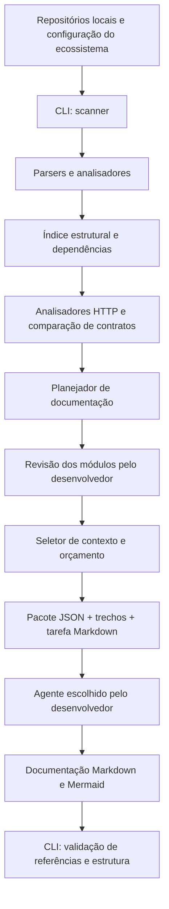

# Plano de implementação — Codebase Documentation Engine

## 1. Decisão arquitetural

**Opção escolhida:** CLI independente da execução de agentes de IA.

A CLI analisa a codebase, constrói um índice estrutural, seleciona evidências e exporta pacotes de contexto. **Não executa Codex, Claude Code, Copilot ou outros agentes.** Cada desenvolvedor escolhe seu agente para consumir os pacotes e produzir a documentação Markdown. A CLI valida os artefatos posteriormente.

### Objetivo do MVP

Documentar funcionalidades de negócio que atravessam frontend Next.js e backend C#/.NET, analisando contratos HTTP/JSON, regras e dependências em um ou vários repositórios locais. Reduzir o consumo de tokens em pelo menos 20% no experimento definido na seção 14, sem aumentar omissões relevantes ou correções humanas.

**Situação:** entendimento compartilhado do escopo e do caso piloto confirmado pelo desenvolvedor em 2026-11-03. Entrevista de definição encerrada. Este documento descreve funcionalidades a implementar; a confirmação não representa implementação concluída nem resultado de eficiência medido.

### Fora do escopo inicial

- Invocar automaticamente agentes ou provedores de modelos.
- Criar servidor MCP, RAG, banco vetorial ou portal web.
- Atualizar a documentação a cada commit ou integrar pipelines CI/CD.
- Garantir automaticamente a correção semântica de todas as regras de negócio.
- Analisar GraphQL, WebSockets e mensageria; esses mecanismos serão reportados como lacunas.
- Executar o sistema analisado para comprovar comportamento em tempo de execução.
- Produzir os seis documentos globais da proposta original; a entrega inicial será um índice e documentos por módulo.

### Alinhamentos da discussão de escopo

- O primeiro resultado deve ajudar o desenvolvedor a compreender um módulo existente, com responsabilidades, dependências e pontos de entrada rastreáveis.
- O MVP deve cobrir o backend C#/.NET e o frontend Next.js em conjunto, permitindo analisar regras e contratos do ecossistema. O recorte inicial não será limitado a uma das stacks.
- A avaliação de utilidade deve demonstrar redução de pelo menos 20% no consumo de tokens sem aumentar omissões relevantes e correções humanas, comparando o mesmo agente com acesso direto aos repositórios. O protocolo deve ser fixado antes do experimento.
- Uma análise pode abranger vários repositórios locais, com caminhos informados pelo desenvolvedor e revisão identificada por repositório.
- Módulo representa uma funcionalidade de negócio que atravessa frontend e backend. Os agrupamentos sugeridos pela ferramenta podem ser ajustados pelo desenvolvedor.
- O MVP deve relacionar chamadas do frontend aos endpoints do backend, comparar formatos de entrada e saída e documentar validações e regras encontradas. Relações incertas devem ser sinalizadas para revisão.
- Um cenário de aceite é identificar um campo tratado como opcional pelo frontend e exigido pelo backend.
- A comunicação coberta inicialmente será HTTP/JSON entre Next.js e C#/.NET. GraphQL, WebSockets, mensageria e outros mecanismos serão sinalizados como lacunas de cobertura.
- A análise buscará regras no frontend e no backend, distinguindo validações de entrada, restrições de interface e decisões de negócio. Uma restrição encontrada na interface não comprova sua aplicação pelo servidor.
- Ligações não determinadas entre chamadas e endpoints serão registradas como relações candidatas, acompanhadas de evidências e motivo da incerteza. Uma relação candidata não poderá sustentar uma afirmação de divergência de contrato.
- A comparação deve considerar o que o frontend efetivamente envia e espera receber e o que o endpoint aceita e retorna, conforme as evidências disponíveis no código. Tipos declarados e OpenAPI são evidências adicionais e podem divergir da implementação; a análise não executará o sistema para comprovar seu comportamento.
- A cobertura inicial inclui Controllers e Minimal APIs no .NET e chamadas com `fetch` e Axios no Next.js, incluindo wrappers locais quando rastreáveis. Chamadas sem resolução serão apresentadas como lacunas.
- O MVP exige repositórios Git sem alterações pendentes. Cada análise será identificada pelo conjunto de commits dos repositórios participantes.
- A confirmação de uma ligação entre frontend e backend exige destino configurado, método HTTP e rota compatíveis. A configuração deve permitir associar URLs aos backends participantes; coincidência de método e rota entre serviços não basta.
- A CLI detectará divergências objetivas de contrato, como campos obrigatórios ausentes e tipos incompatíveis, explicando cada comparação e suas fontes. Serialização, tipos ou validações não resolvidos devem produzir lacunas, não conclusões de incompatibilidade.
- O agente externo interpreta e redige regras de negócio com base nas evidências fornecidas; a CLI permanece responsável pelas verificações determinísticas.
- O planejamento sugerirá módulos a partir de rotas e dependências. O desenvolvedor deverá revisar o plano antes da exportação dos pacotes de documentação; o plano revisado será persistido para reutilização.
- Cada afirmação sobre comportamento ou contrato deverá citar identificadores de evidência do pacote, vinculados a repositório, commit, arquivo, símbolo, linhas e hash. O validador verifica referências e integridade das fontes; isso não comprova a correção da conclusão.
- Quando um módulo exceder o orçamento de contexto, será dividido em tarefas menores, preservando os trechos necessários para comparar cada chamada com seu endpoint e explicitando exclusões. Se uma comparação isolada não couber, será necessário aumentar o orçamento ou reduzir o escopo; não haverá corte silencioso de código.
- O resultado da validação terá dimensões independentes para integridade das evidências, atualização das fontes e revisão humana do conteúdo, conforme a seção 11.
- Mudanças em qualquer repositório participante entre análise e exportação bloqueiam a exportação e exigem nova análise. Para documentos existentes, a validação distingue a integridade das evidências originais da atualidade das fontes.
- Divergências envolvendo obrigatoriedade condicional só serão afirmadas quando a análise demonstrar que a chamada satisfaz a condição e omite o campo. Condições não resolvidas serão encaminhadas para revisão.
- Cada pacote incluirá um relatório de cobertura com chamadas confirmadas, relações candidatas, chamadas não resolvidas e motivos das lacunas. A ausência de divergências não implica cobertura completa.
- A entrega será um índice do ecossistema e documentos por módulo, reunindo fluxo entre frontend e backend, contratos, regras encontradas, divergências, evidências e lacunas.
- O mapeamento entre URLs e backends será informado em configuração sem credenciais. Arquivos sensíveis permanecem excluídos; destinos dependentes deles exigem mapeamento seguro e permanecem como lacunas enquanto não forem resolvidos.
- O aceite exige detectar todos os casos de divergência previamente definidos nos projetos de teste e não afirmar divergências nos casos ambíguos. Casos e avaliação de qualidade devem ser definidos antes do experimento.
- O piloto inclui os três repositórios de MSSUPERA no inventário e começa a documentação detalhada pelo fluxo do portal de dados socioeconômicos, responsável financeiro e pré-validação da finalização da inscrição. Upload de documentos permanece como lacuna fora desse recorte.
- O MVP deve rastrear a cadeia navegador → rota API Next.js → backend C#, incluindo transformações do corpo e dos parâmetros nos intermediários. A comparação não pode ignorar essas transformações.

## 2. Princípios

1. **Análise determinística primeiro:** usar parsing, metadados e referências antes de IA.
2. **Agnóstico de agentes:** contratos em JSON, Markdown e arquivos de código, sem SDK proprietário.
3. **Agnóstico de linguagens por extensão:** interface comum e analisadores específicos por linguagem/framework.
4. **Evidência rastreável:** associar afirmações a arquivo, símbolo, intervalo de linhas e revisão Git.
5. **Processamento seletivo:** priorizar módulos, dependências relevantes e orçamento de contexto.
6. **Falhas explícitas:** registrar lacunas, ambiguidades e limites do analisador, sem inventar fatos.
7. **Segurança local:** ignorar segredos e arquivos sensíveis; não transmitir código por padrão.

## 3. Arquitetura



### Responsabilidades

| Componente | Responsabilidade | Usa IA? |
|---|---|---|
| Scanner | Descobrir arquivos, projetos, linguagens, manifests e frameworks | Não |
| Parser | Extrair símbolos, localizações e imports | Não |
| Analisador | Extrair contratos HTTP, confirmar ou propor relações e comparar contratos com evidências e lacunas | Não |
| Planejador | Sugerir módulos e persistir os agrupamentos revisados pelo desenvolvedor | Não |
| Seletor | Preparar contexto por módulo e limite aproximado de tokens | Não |
| Agente externo | Interpretar fluxos e redigir explicações a partir de evidências | Sim |
| Validador | Conferir estrutura, fontes, hashes, links e rastreabilidade | Não |

## 4. Stack inicial

- **Python 3.12+** para CLI multiplataforma.
- **Typer** para interface de comandos.
- **Tree-sitter** para análise sintática de C# e TypeScript.
- **Pydantic** para contratos e schemas JSON.
- **SQLite** para cache local e índices persistentes, quando necessário.
- **Pytest** para testes.
- **Markdown e Mermaid** para documentação final.
- Plugins opcionais posteriores: **Roslyn** (.NET) e **TypeScript Compiler API** (TypeScript) para análise semântica mais precisa.

Tree-sitter não resolve por si só resolução completa de tipos, injeção de dependência, chamadas dinâmicas ou convenções específicas de frameworks. O MVP exige analisadores específicos para Controllers, Minimal APIs, `fetch`, Axios, wrappers locais rastreáveis e rotas API do Next.js. Devem ser rastreados os intermediários e suas transformações de corpo e parâmetros. O suporte de cada padrão deve ser comprovado por testes; sintaxe reconhecida não equivale a contrato resolvido. A necessidade de análise semântica adicional deverá ser avaliada com o caso piloto, sem afirmar conclusões quando a extração for insuficiente.

## 5. Estrutura sugerida

```text
codebase-doc-engine/
├── pyproject.toml
├── README.md
├── src/codedoc/
│   ├── cli.py
│   ├── core/
│   │   ├── config.py
│   │   ├── models.py
│   │   ├── scanner.py
│   │   └── cache.py
│   ├── parsers/
│   │   ├── base.py
│   │   ├── treesitter.py
│   │   └── registry.py
│   ├── analyzers/
│   │   ├── symbols.py
│   │   ├── dependencies.py
│   │   ├── http_contracts.py
│   │   ├── contract_matching.py
│   │   ├── contract_comparison.py
│   │   └── architecture.py
│   ├── context/
│   │   ├── selector.py
│   │   ├── budget.py
│   │   └── exporter.py
│   └── documentation/
│       ├── planner.py
│       └── validator.py
├── prompts/
│   ├── document-module.md
│   ├── architecture.md
│   └── business-rules.md
├── schemas/
│   ├── inventory.schema.json
│   └── context.schema.json
└── tests/
```

Estrutura de saída do ecossistema, em diretório configurado pelo desenvolvedor:

```text
MeuEcossistema/
├── docs/
│   ├── index.md
│   ├── modules/
│   └── flows/
└── .codedoc/
    ├── config.yaml
    ├── inventory.json
    ├── symbols.json
    ├── dependencies.json
    ├── contracts.json
    ├── findings.json
    ├── plan.json
    ├── cache.db
    └── contexts/<modulo>/
        ├── context.json
        ├── task.md
        ├── coverage.json
        └── sources/
```

Adicionar cache e contextos temporários ao `.gitignore`; versionar apenas a configuração, o plano revisado e a documentação que a equipe decidir manter. SQLite permanece opcional; o MVP não exige cache incremental entre revisões.

## 6. Contrato intermediário

Exemplo **ilustrativo** de `context.json`:

```json
{
  "schema_version": "1.0",
  "repositories": [
    {"id": "api", "revision": "<commit-completo-backend>"},
    {"id": "web", "revision": "<commit-completo-frontend>"}
  ],
  "module": "Atendimentos",
  "languages": ["csharp", "typescript"],
  "symbols": [
    {
      "id": "api:AtendimentoService.CriarAsync",
      "repository_id": "api",
      "kind": "method",
      "file": "Application/AtendimentoService.cs",
      "start_line": 35,
      "end_line": 88
    }
  ],
  "dependencies": [
    {
      "from": "AtendimentoService",
      "to": "IAtendimentoRepository",
      "type": "dependency"
    }
  ],
  "evidence": [
    {
      "id": "ev-api-criar",
      "repository_id": "api",
      "revision": "<commit-completo-backend>",
      "source_hash": "<hash-do-arquivo-na-revisao>",
      "symbol": "api:AtendimentoService.CriarAsync",
      "source": "Application/AtendimentoService.cs",
      "range": [35, 88]
    }
  ]
}
```

O schema definitivo deverá incluir identificadores estáveis qualificados por repositório, contratos HTTP, relações confirmadas ou candidatas, achados, confiança da extração, avisos e cobertura. Caminhos devem ser relativos à raiz do repositório identificado; referências devem apontar para o commit completo analisado. O exemplo não define ainda o schema executável.

Cada afirmação sobre comportamento ou contrato no Markdown deverá citar um identificador de evidência do pacote. A sintaxe exata das citações e os schemas serão definidos junto ao validador, antes da geração dos documentos de teste.

## 7. Comandos planejados

> Estes comandos definem a interface **a implementar**; não são uma CLI já disponível.

```bash
# Descobrir estrutura e tecnologias
codedoc scan --config ./ecosystem.yaml

# Construir índice estrutural e dependências
codedoc analyze --config ./ecosystem.yaml

# Criar plano de documentação
codedoc plan --config ./ecosystem.yaml --output .codedoc/plan.json

# Exportar contexto de um módulo, com orçamento aproximado
codedoc context --config ./ecosystem.yaml --module Atendimentos --budget 12000

# Validar documentos produzidos pelo agente
codedoc validate ./docs --config ./ecosystem.yaml
```

A configuração deve identificar repositórios e caminhos locais, mapeamentos seguros de URLs para backends, caminhos de saída, exclusões, linguagens e limites de contexto. Todos os comandos devem aceitar a mesma configuração, inclusive quando executados fora das raízes dos repositórios. Os nomes das opções são uma proposta de interface.

## 8. Processo de documentação

1. Desenvolvedor configura os repositórios locais e os destinos HTTP sem credenciais e executa `scan` e `analyze` com os repositórios Git sem alterações pendentes.
2. `plan` sugere módulos a partir de rotas e dependências; o desenvolvedor revisa os agrupamentos e persiste o plano antes da exportação.
3. `context` seleciona símbolos, dependências e trechos de código necessários para um documento.
4. A CLI verifica se os repositórios permanecem na revisão analisada e sem alterações pendentes; divergências bloqueiam a exportação e exigem nova análise. Exporta `context.json`, `sources/`, `task.md` e `coverage.json`.
5. O desenvolvedor entrega esse pacote ao agente de sua preferência.
6. O agente produz Markdown e, quando útil, diagramas Mermaid.
7. `validate` verifica links, caminhos, símbolos, intervalos, hashes e seções obrigatórias.
8. O desenvolvedor revisa inferências, regras de negócio e lacunas sinalizadas.

### Política de seleção de contexto

- Priorizar símbolos que implementam a funcionalidade solicitada.
- Incluir dependências diretas relevantes, validadores, contratos e pontos de entrada.
- Usar relações do grafo para ampliar contexto quando necessário.
- Excluir arquivos gerados, binários, dependências vendorizadas e segredos.
- Evitar truncamento arbitrário de métodos; dividir fluxos grandes em pacotes.
- Registrar quais arquivos ficaram de fora e por quê.
- Tratar o orçamento de tokens como estimativa dependente do modelo/tokenizador.
- Preservar os trechos necessários para comparar chamada e endpoint ao dividir um módulo em tarefas. Se uma comparação isolada exceder o limite, exigir aumento de orçamento ou redução do escopo.
- Incluir no relatório de cobertura chamadas confirmadas, relações candidatas, chamadas não resolvidas e motivos das lacunas.

## 9. Contrato de instruções para qualquer agente

Arquivo sugerido: `prompts/document-module.md`.

```markdown
# Tarefa: documentar módulo de software

## Entradas
- context.json: símbolos, dependências e metadados.
- sources/: trechos selecionados do código.
- task.md: escopo, módulo e caminho de saída.

## Regras
1. Utilize apenas evidências fornecidas.
2. Não invente regras de negócio, integrações ou comportamentos.
3. Diferencie fatos verificados de inferências.
4. Cite identificadores de evidência do pacote em cada afirmação sobre comportamento ou contrato; preserve o vínculo com repositório, commit, arquivo, símbolo, linhas e hash.
5. Registre lacunas quando o contexto for insuficiente.
6. Não altere código-fonte.
7. Produza Markdown seguindo o template.

## Saída
- Responsabilidade do módulo
- Componentes e dependências
- Funcionalidades identificadas
- Regras de negócio
- Validações de entrada e restrições de interface, distinguindo-as das regras garantidas no backend
- Contratos HTTP e divergências demonstradas pela CLI
- Fluxos principais
- Integrações
- Evidências e pontos para revisão

Não declare validação concluída: ela será executada separadamente.
```

A CLI **não** escolhe nem invoca o agente. A forma de abrir arquivos e submeter a tarefa fica a cargo de cada desenvolvedor.

## 10. Documentação alvo

```text
docs/
├── index.md
├── modules/
│   └── <modulo>.md
└── flows/
```

A entrega inicial contém um índice do ecossistema e documentos por módulo com responsabilidades, dependências, pontos de entrada, fluxos entre frontend e backend, contratos, regras, divergências e lacunas. Diagramas opcionais ficam em `docs/flows/` ou no Markdown do módulo. Os seis documentos globais da proposta original ficam para evolução.

Cada documento deve conter objetivo, commits dos repositórios participantes, evidências, lacunas e status de revisão. Diagramas devem distinguir relações confirmadas de candidatas.

## 11. Validação e estados

| Camada | Verificação | Limite |
|---|---|---|
| Estrutural | Markdown, links, arquivos, símbolos, seções obrigatórias | Automatizável |
| Evidências | Referências, hashes, revisão Git e intervalos | Automatizável |
| Semântica | Regras de negócio e explicações refletem o sistema | Requer revisão humana em casos complexos |

O resultado terá três dimensões independentes:

- **Integridade das evidências:** referências e fontes na revisão original podem ser verificadas ou apresentar falhas; impossibilidade de acessar a fonte deve ser informada.
- **Atualização das fontes:** comparar as fontes atuais com as evidências originais, distinguindo documentação atual, desatualizada ou cuja atualização não foi possível determinar.
- **Revisão humana:** registrar se o conteúdo ainda aguarda revisão e o resultado da revisão quando realizada. Validação automática não aprova o conteúdo.

Uma documentação pode ter evidências íntegras, estar desatualizada e ainda aguardar revisão. Estrutura e referências válidas não garantem correção semântica, nem cobertura completa.

## 12. Segurança

- Respeitar `.gitignore` e exclusões configuráveis, mas não presumir que `.gitignore` exclui todos os segredos.
- Bloquear por padrão `.env`, chaves privadas, certificados, tokens e dumps sensíveis.
- Não ler arquivos sensíveis para resolver URLs. Exigir mapeamento seguro sem credenciais; enquanto ausente, registrar lacuna de destino.
- Não executar código do repositório durante o scanner.
- Não fazer upload ou chamadas de rede automaticamente.
- Registrar somente metadados necessários nos logs; evitar exposição de trechos sensíveis.
- Revisar o uso de agentes externos conforme as políticas da empresa.

## 13. Backlog do MVP

- [ ] Criar projeto Python, Typer, Pydantic e Pytest.
- [ ] Implementar scanner com exclusões e detecção de tecnologias.
- [ ] Integrar Tree-sitter para C# e TypeScript.
- [ ] Extrair símbolos com arquivo, linhas e identificador estável.
- [ ] Extrair imports e dependências básicas.
- [ ] Identificar análises pelo conjunto de commits e bloquear exportação após mudanças ou com alterações pendentes.
- [ ] Extrair endpoints de Controllers e Minimal APIs e chamadas com `fetch`, Axios e wrappers locais rastreáveis.
- [ ] Rastrear a cadeia navegador → rota API Next.js → backend e as transformações de corpo e parâmetros, incluindo o desembrulho de `req.body.formData` observado no piloto.
- [ ] Modelar parâmetros, corpos de requisição, respostas, obrigatoriedade e tipos com evidências e limites explícitos.
- [ ] Confirmar ligações por destino configurado, método e rota; registrar candidatos e lacunas.
- [ ] Comparar contratos e explicar divergências demonstráveis sem concluir sobre condições ou serializações não resolvidas.
- [ ] Criar inventário e plano de módulos revisável e persistente.
- [ ] Implementar seleção de contexto por módulo e orçamento.
- [ ] Dividir módulos preservando comparações completas e explicitar insuficiência de orçamento.
- [ ] Exportar `context.json`, `sources/`, `task.md` e `coverage.json`.
- [ ] Definir prompts universais independentes de agente.
- [ ] Definir schemas e sintaxe de citações e implementar validador de referências e Markdown com três dimensões de resultado.
- [ ] Criar índice do ecossistema e template de documentação por módulo.
- [ ] Definir previamente casos de teste positivos, negativos e ambíguos e protocolo de avaliação.
- [ ] Testar em funcionalidade real que atravesse .NET e Next.js e executar o experimento de eficiência.

### Critérios de aceite do MVP

1. Scanner roda localmente e não envia código para serviços externos.
2. Projetos de teste cobrem Controllers, Minimal APIs, `fetch`, Axios e wrappers locais rastreáveis, com resultados esperados definidos previamente.
3. Cada pacote identifica os commits dos repositórios, referências verificáveis e cobertura; mudanças posteriores à análise bloqueiam a exportação.
4. O mesmo pacote pode ser consumido por pelo menos dois agentes distintos, sem transformação proprietária.
5. Validador identifica links quebrados, fontes inexistentes e divergência de revisão/hash.
6. É possível documentar um módulo sem fornecer a codebase inteira ao agente.
7. Todos os casos de divergência previamente definidos nos projetos de teste são detectados; casos ambíguos não geram afirmações de divergência. Os casos incluem campo opcional no frontend e exigido no backend, incompatibilidade de tipos, obrigatoriedade condicional e destinos ambíguos.
8. A entrega contém índice e documentação de uma funcionalidade real atravessando frontend e backend, com plano de módulos revisado pelo desenvolvedor.
9. O experimento apresenta redução de pelo menos 20% nos tokens, sem aumento de omissões relevantes ou correções humanas. Essa meta não constitui resultado medido nem garantia de desempenho.
10. O piloto inventaria API, portal e administração e documenta o fluxo de dados socioeconômicos, responsável financeiro e pré-validação da finalização. A comparação acompanha as transformações nas rotas API do Next.js; upload e SignalR são registrados como lacunas.

## 14. Experimento de eficiência

Comparar:

- **Baseline:** agente lê os repositórios diretamente.
- **Híbrido:** agente recebe o pacote produzido pela CLI.

Medir tokens consumidos, tempo, cobertura, precisão das referências, omissões relevantes e correções humanas necessárias. Usar o mesmo módulo, conjunto de commits, objetivo e agente em sessões separadas. Fixar antes da execução os casos esperados e a avaliação de qualidade; documentar método de contagem de tokens e limitações da medição.

Meta: `tokens_hibrido <= 0,80 × tokens_baseline`, sem aumento de omissões relevantes ou correções humanas. Tempos de análise e preparação da CLI também serão registrados. O piloto está definido na seção 15; o protocolo detalhado e os recursos de medição ainda precisam ser escolhidos. Resultados não serão presumidos.

## 15. Sistema e funcionalidade piloto

O diretório informado pelo desenvolvedor é `C:\SETDIG\MSSUPERA`. A inspeção inicial encontrou três projetos:

| Papel | Diretório | Evidência inicial |
|---|---|---|
| Backend | `k0692-mssuperaweb-api` | Solução e projetos C# sob `src/` |
| Portal | `k0701-mssuperasite-front` | `package.json` declara Next.js e Axios |
| Administração | `k1095-mssuperaadm` | `package.json` declara Next.js e SignalR |

O piloto incluirá os três repositórios no inventário, com documentação detalhada inicial do fluxo do portal descrito abaixo. Essa inclusão não confirma automaticamente destinos HTTP, ligações entre os projetos ou suporte completo aos padrões usados. A documentação existente em `MSSUPERA/docs` pode orientar a investigação, mas suas afirmações precisam ser confrontadas com as fontes.

### Inspeção inicial do código — 2026-11-03

O fluxo escolhido é **dados socioeconômicos, responsável financeiro e pré-validação da finalização da inscrição**. Evidências relativas à raiz de cada repositório:

- Portal: `src/components/FormularioDadosSociais/FormularioDadosSocias.tsx:573` prepara o envio para `DadosSociaisEstudante/postput`; `src/pages/api/DadosSociaisEstudante/postput.ts:10` encaminha o pedido por `proxyRequest`, extraindo `req.body.formData` como corpo do POST ao backend.
- API: `src/MSSUPERAWEBAPI/Controllers/DadosSociaisEstudanteController.cs:41` declara o POST correspondente; o método usa um ViewModel qualificado por namespace, AutoMapper e serviço. Existem ViewModels homônimos em projetos distintos, exigindo desambiguação.
- Portal: `src/utils/responsavelFinanceiroUnipessoal.ts:19` expressa a condição de responsável financeiro envolvendo composição familiar unipessoal, renda zero e ausência de benefícios.
- API: `src/MSSUPERA.Business/Services/InscricaoEstudanteService.cs` contém `ValidarFinalizarInscricao`, `RequerResponsavelFinanceiro` e `ObterPendenciasResponsavelFinanceiro`. A equivalência entre condições do frontend e backend ainda precisa ser avaliada; a inspeção não afirma divergência.
- Administração: `src/utils/routesHelper/fetchClient.tsx` e `fetchNextApi.ts` participam da cadeia cliente → rota API Next.js → backend. O portal também usa uma etapa intermediária em `pages/api`, com Axios no proxy.
- O fluxo completo de finalização inclui upload multipart/PDF; a administração usa SignalR. Esses mecanismos ultrapassam o recorte HTTP/JSON e serão registrados como lacunas fora do piloto.

Revisões observadas, para contextualizar a inspeção; não constituem ainda uma análise válida do MVP:

| Repositório | Commit | Estado observado |
|---|---|---|
| API | `173916e3fb4eb98963391be94f84f6f3453f1bac` | Sem alterações pendentes |
| Portal | `66de21d5663c0fca48d7dbeb0f7e6e17b651a4b3` | Alteração pendente em `tsconfig.json` |
| Administração | `6c340623730b9391190e1c7986bd72992d5df614` | Sem alterações pendentes |

A alteração do portal foi preservada. Pelo critério acordado, o piloto exigirá uma árvore limpa antes da análise. A inspeção foi somente leitura e não resolveu configurações de destino a partir de arquivos sensíveis.

### Detalhamento de engenharia antes do experimento

Os schemas executáveis, a sintaxe de citações, a matriz de padrões suportados e o protocolo de medição devem ser definidos e testados antes do experimento. O caso piloto deve orientar a avaliação de suficiência dos analisadores sintáticos, sobretudo para ViewModels homônimos, AutoMapper, validações condicionais e transformações nos proxies. Pontos não resolvidos devem reduzir a cobertura declarada, sem produzir conclusões não demonstradas.

Esses detalhes ainda não constituem contratos implementados. Não há CLI, análise executável ou resultados de eficiência disponíveis neste workspace.

## 16. Evolução futura (não implementar no MVP)

- Cache incremental por hash e análise de impacto por commit.
- Plugins semânticos Roslyn e TypeScript Compiler API.
- Integração opcional com CI/CD e atualização de documentação em PRs.
- Servidor MCP somente leitura.
- Portal de documentação e catálogo multi-repositório.
- Documentos globais separados de arquitetura, regras de negócio, fluxos e integrações.
- Execução opcional de agentes por adaptadores, caso a equipe decida habilitá-la.

---

**Resumo da decisão:** construir primeiro uma CLI local e agnóstica que prepara contexto verificável para documentação, sem executar IA. O desenvolvedor utiliza seu agente preferido e a CLI valida os resultados.
